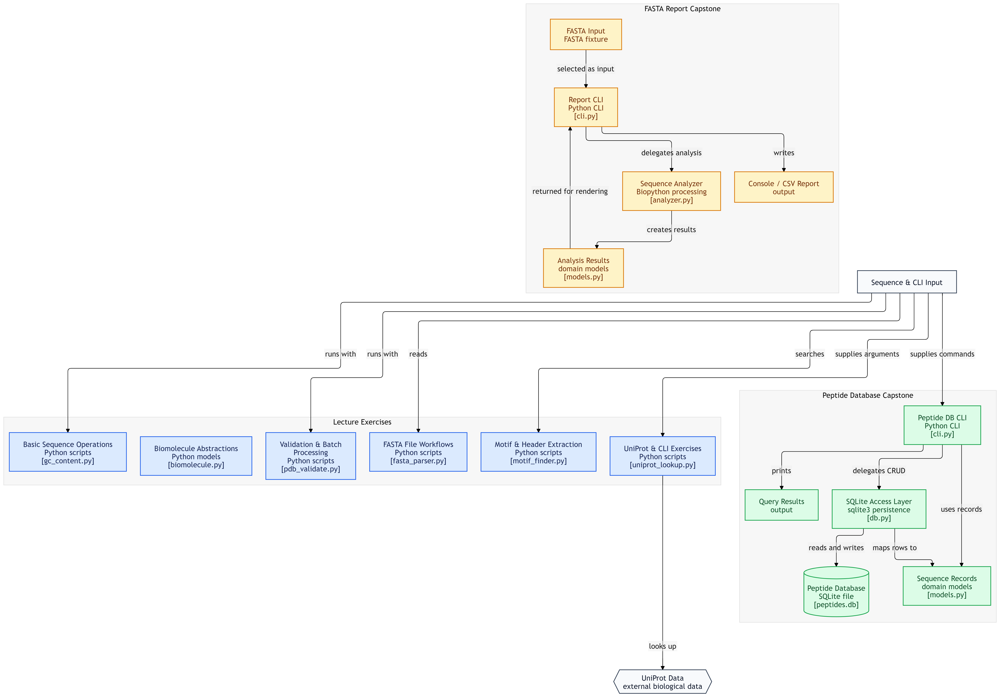

<h1 data-importer="text" align="left">Protein Python Foundations</h1>

###

<div data-importer="image" align="left">
  
</div>

###

<p data-importer="text" align="left">Original Python practice problems applying core programming fundamentals (functions, variables, string methods, type conversion, OOP, file I/O, regular expressions) to small biological and protein-science scenarios — written while working through Harvard's CS50P alongside a self-directed computational proteomics roadmap.</p>

###

<div data-importer="techs" align="left">
  
  
  
  
  
  
  
  
  
  
  
  
  
  
  
  
  
  
  
  
  
  
  
  
  
  
</div>

## What this is

Independent practice problems solved while working through CS50P lecture by
lecture (Functions & Variables through Object-Oriented Programming), each
one a small biology- or chemistry-flavored scenario built to reinforce that
lecture's specific concept, plus two larger capstone projects built after
course completion that combine everything into standalone tools.

## What this is not

Not a repository of official CS50P problem set solutions. Official
coursework is submitted privately through CS50's own `submit50` pipeline,
per CS50's academic honesty policy, and is not published here or anywhere
public. Everything in this repo is original, independently designed
scenarios and tools — not CS50 assessments, and not the CS50P final project
(which, per the same policy, also stays private).

For the actual research portfolio this feeds into:
- **`egfr-integrative-proteogenomics`** — the flagship project this
  foundation feeds into (not yet started; see the master plan for timing)
- [`protein-r-foundations`](https://github.com/Afraim10/protein-r-foundations) — the R equivalent of this repo, same stage of the same roadmap

## Structure

<p align="left">
  
</p>

*The diagram above maps to the folder layout below.*

```
lecture0/  through  lecture8/
  — one folder per CS50P lecture, biology-themed practice problems

capstone-peptide-db/
  models.py, db.py, cli.py, test_db.py
  — SQLite-backed CLI for storing and querying DNA/protein records

capstone-fasta-report/
  models.py, analyzer.py, cli.py, test_analyzer.py
  — batch FASTA analyzer: auto-detects DNA vs. protein, reports GC content
    or estimated mass, outputs to console or CSV
```

Each lecture folder's files are self-contained and runnable directly:
```bash
python clean_sequence.py
```
Each capstone has its own README with a full breakdown of its files, design
decisions, and known limitations.

## Environment

Standard library throughout the lecture folders. The capstones add
`biopython`, and the peptide database additionally uses Python's built-in
`sqlite3` — no external database server required.

## How this was done

<div data-importer="image" align="left">
  
</div>

Each lecture's problems were attempted independently against that week's
CS50P material, applying the concept to an original scenario rather than
the course's own examples. The two capstones were designed independently —
schema, architecture, and logic decisions are mine — though SQL specifically
was genuinely new territory going into the peptide database project, and
its exact syntax was researched rather than already known. That's noted
directly in that capstone's own README rather than left implicit.

## Status
Complete. All lectures and the final projects were finished section by section as the course progressed.

- [x] Lecture 0 — Functions, Variables
- [x] Lecture 1 — Conditionals
- [x] Lecture 2 — Loops
- [x] Lecture 3 — Exceptions
- [x] Lecture 4 — Libraries
- [x] Lecture 5 — Unit Tests
- [x] Lecture 6 — File I/O
- [x] Lecture 7 — Regular Expressions
- [x] Lecture 8 — Object-Oriented Programming
- [x] Capstone — Peptide/Sequence Database (SQLite)
- [x] Capstone — FASTA Batch Analyzer

## About

Part of a self-directed roadmap toward computational proteomics and
protein design. See [github.com/Afraim10](https://github.com/Afraim10)
for other projects.
